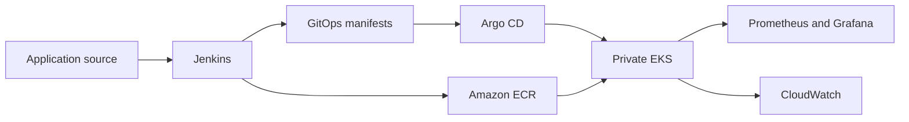

# Roadmap Delivery on EKS

An AWS DevOps portfolio project for a three-service roadmap application. Jenkins builds, tests, and scans the source. Amazon ECR stores release images. Argo CD applies Kustomize manifests to a private EKS cluster, and Prometheus and Grafana monitor the workload.



## Run locally

From the `01-Docker` directory, copy `.env.example` to `.env` and replace the example passwords. Set `SESSION_SECRET` to at least 32 random characters, such as the output of `openssl rand -hex 32`. Run `docker compose up --build --wait` and open [localhost:3000](http://localhost:3000). To stop the stack, run `docker compose down`.

## Deploy to AWS

1. Review the [Terraform configuration](02-Terraform/README.md), bootstrap the S3 backend if needed, and plan against an AWS account you control. EKS, NAT, EC2, and load balancers incur charges.
2. Set `operator_access_cidrs` for Jenkins and SSH. The EKS API is private by default, and Jenkins reaches it over HTTPS within the VPC. A workstation needs VPC connectivity or an approved `eks_public_access_cidrs` entry.
3. Configure the [Jenkins jobs](05-Jenkins/README.md) and AWS credentials through the instance role. Set `DEPLOY_ECR_REGISTRY` from `terraform output -raw ecr_registry`, `DEPLOY_AWS_REGION` to the deployment region, and `GITOPS_REPOSITORY` to the GitHub repository in `github.com/owner/repo.git` form.
4. Provision the runtime Secret before the first Argo CD sync. Replace the example ECR references, image tags, DNS names, certificate ARN, and ingress CIDRs in the Kubernetes and monitoring configuration with values from your deployment. Set Terraform’s `ingress_domain` if it should request the ACM certificate.
5. Apply the [AppProject](06-ArgoCD/project.yaml) and [Application](06-ArgoCD/applications/ivolve-app.yaml), which both point to this repository. Confirm the first sync is healthy before enabling external integrations.

### Runtime secrets

Create the namespace and provide an access-controlled environment file outside the checkout with `MYSQL_ROOT_PASSWORD`, `MYSQL_PASSWORD`, `DB_PASSWORD`, and `SESSION_SECRET`. Use the same generated application password for `MYSQL_PASSWORD` and `DB_PASSWORD`.

```sh
kubectl apply -f 04-Kubernetes/manifests/00-namespace.yaml
kubectl -n ivolve create secret generic ivolve-secret --from-env-file=/secure/path/roadmap.env
```

For an existing database, coordinate password changes with the database user and workloads before updating the Secret. Remove sensitive files according to your team's secret-handling process.

The administrative ALB routes match the source IP seen by the ALB. Use a controlled direct route or a private administrative path if a proxy sits in front of the load balancer. The frontend uses secure session cookies behind the HTTPS listener.

## Verify releases

- `terraform -chdir=02-Terraform validate`
- `kubectl kustomize 04-Kubernetes/manifests`
- Verify the image tag update in Git and the Argo CD sync status.
- Check the frontend, authentication, and roadmap services before promoting another image. Revert the GitOps image-tag commit to roll back.

See the [operations runbook](docs/RUNBOOK.md) and [monitoring configuration](07-Monitoring/README.md).

## Attribution

Based on [Waleed Darwesh’s Cloud DevOps Capstone](https://github.com/WaleedDarwesh/CloudDevOpsProject). The original [MIT license](LICENSE) and source notices are retained.
